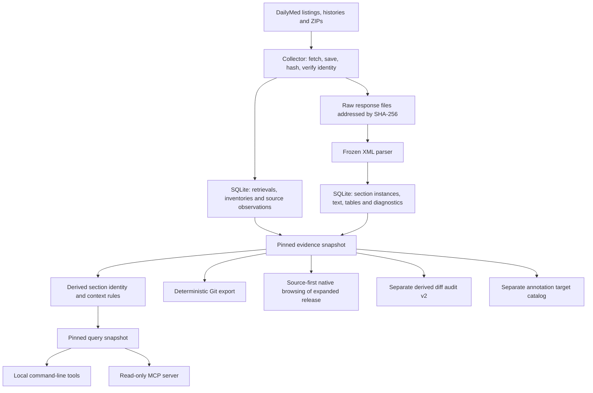

# GitRx, explained from the beginning

> Core label-history features are now runnable: [CLI and MCP workflow](../../CORE-WORKFLOW.md).


> Portable backend foundation (November 6): see the [installed native CLI and configuration guide](../../BACKEND-PACKAGING.md) and [v1 contract](../../PRODUCTION-CONTRACT.md).

> November 6 update: the 15 recoveries are admitted, the Git policy is selected,
> and the human labeling disagreement is adjudicated without a classifier change.
> Read [current build status](../../BUILD-STATUS.md) and [the continuation report](../../../reports/continuation-20261106/REPORT.md) for the new state; this tutorial retains the November 5 architectural explanation.

Consolidated on **November 5, 2026 (America/Chicago)** from the three project chats, the workspace documents, current operational metadata, and the implementation. Start here for understanding; use [BUILD-STATUS.md](../../BUILD-STATUS.md) for exact progress and next steps, and [DOCUMENT-MAP.md](../../DOCUMENT-MAP.md) to find the older evidence.

## 1. What are we building?

**GitRx is a history browser and evidence archive for drug-label documents.**

A drug label is the long document describing a product's uses, dosing, warnings, and other information. The project captures versions published by DailyMed and makes their history inspectable. Think of Wikipedia's “View history,” with a saved copy of the original source behind every answer.

The central questions are:

- When does a particular phrase first appear in the captured history?
- When does a particular section first appear?
- What does the captured DailyMed record show by a particular publication date?
- What text differs between two versions?
- Which exact source files support the answer, and what evidence is missing?

The broader ambition is an open, citable resource for researchers and developers of AI tools, with a data-resource paper and later studies of label changes. The current implementation is local research infrastructure. Downloading a large corpus, validating its interpretation, and publishing a resource are separate milestones.

The project describes **DailyMed's published label-family record**. It does not establish FDA approval, legal applicability, what accompanied a dispensed product, why a warning changed, or when a medical risk became known. Those would require additional evidence and different research designs.

## 2. Why the original idea grew

Claude's original idea—one Git commit per label version—is a useful product sketch. The work since then has been about making its answers trustworthy.

“When was this warning added?” sounds like a text-search problem. In practice, the program first has to establish that it downloaded the requested version, extracted its text, selected the right section, distinguished the full label from a patient leaflet, and checked the predecessor. If any of those fail, a neat-looking date can be wrong.

Most of the project's complexity protects those steps. It has grown into five connected systems:

1. A collector that preserves source evidence.
2. A parser that turns XML into structured, searchable records.
3. An interpretation and query layer that explains sections and uncertainty.
4. A reproducible Git exporter and release process.
5. A validation system that tests extraction and interpretation separately.

The MCP server and annotation validator sit around these systems. They do not replace the archive.

## 3. The architecture that actually exists



There are two important branches. Queries use derived section/context information. The Git exporter uses pinned source evidence and parsed sections without exporting the context classifier's conclusions. A classifier revision should not silently change the source record.

**Raw files plus SQLite form the authoritative local archive. Git is a generated representation of that archive.** This is the biggest architectural change from the original proposal, which put Git at the center and described SQLite as disposable.

Parts of SQLite are rebuildable: extracted text, search indexes, and context assignments. Other parts contain evidence that is not recoverable from successful label ZIPs alone: failed requests, history responses, publication observations, conflicts, and snapshot selections. Back up the database together with the raw artifacts.

### Original proposal versus the current build

| Claude's original sketch | What exists today |
|---|---|
| Every version of every US drug label | Bounded DailyMed human-Rx cohorts; the current large run targets source-category NDA/BLA families |
| Git is the authoritative record; SQLite is rebuilt from it | Raw bytes plus source-observation SQLite are authoritative; Git is generated from pinned selections |
| One Markdown file per named section | Three structured JSON files per family in the current exporter, preserving individual section occurrences |
| Labeler is Git commit author | Fixed GitRx Archive author/committer identity |
| Publication ordering guarantees append-only growth | Family-version queues merged by publication observations; expanded builds currently produce new histories and IDs |
| Sixteen shard submodules plus meta repo | Sixteen local first-hex shard repositories and a SHA-pinned meta repo; public distribution remains pending |
| Corpus-wide `changes`, `when-added`, `blame` | Family phrase/section history, `show`, and `diff`; separate v2 diff audit; broader tools planned |
| Daily automated updates | Bounded historical acquisition; daily incremental service still planned |
| Community YAML, URL-resolution CI, commit-pinned claims | Local JSON schema/validator and raw/snapshot/ordinal targets; URL syntax checks, no network link checker or real claims |

These changes do not discard the history-browser idea. They distinguish preserved evidence from generated interpretations and publication formats.

## 4. The vocabulary, using one imaginary label

Suppose DailyMed has a label with set ID `ab12…`, and our captured history lists versions 1, 3, and 4.

| Term | Meaning | Example |
|---|---|---|
| Label family / setid | One document lineage that the project follows | `ab12…` |
| Version | An integer revision within that lineage | v3 |
| SPL | Structured Product Labeling: the source document format | XML inside a downloaded ZIP |
| XML | Structured text with tags describing a hierarchy | A section contains a title, narrative, and subsections |
| Artifact | A saved byte sequence | The exact downloaded ZIP or a history JSON response |
| SHA-256 | A fingerprint of exact bytes | Changing the ZIP's bytes changes its expected fingerprint |
| Retrieval | One attempt to obtain something | URL, time, response status, headers, and body hash |
| Parse run | One recorded extraction using a particular parser/configuration | Parse v3 with the frozen parser |
| Section instance | One actual occurrence of a section in that document | The second warning-coded section, at ordinal 17 |
| Context | The document part containing that instance | Full-label body, Highlights, Medication Guide, etc. |
| Snapshot | A frozen manifest specifying exactly which evidence/interpretation is selected | Evidence snapshot A; query snapshot B |
| Diff | A description of differences between two versions | Removed words and added words |
| Cohort / tranche | A selected group / processing batch | 500 families in a release1 tranche |

A family is **not the same thing as a drug ingredient or brand**. Several set IDs may relate to similar products. The current system does not automatically combine them into one universal medicine history. A familiar name is only a way to choose an unambiguous stored family.

Likewise, version 4 does not mean four published versions were captured. Our example lists only three. The missing integer 2 is “not listed in this captured history,” not a document we are entitled to invent.

## 5. Why save both an artifact and a retrieval?

Imagine two URLs both return the same 17-byte error page. The content-addressed store can save those bytes once. SQLite still records two attempts, because the URLs and times differ.

The same principle applies to successful downloads. Reusing identical bytes saves space without erasing where or when they were obtained.

The raw store uses paths shaped like:

```text
artifacts/sha256/<first-two-hash-characters>/<complete-sha256>
```

Release1 and other cohorts have their own storage roots. A root contains a database, artifact paths, and related manifests. Some verified local copies use hard links: multiple paths can refer to the same physical bytes. Deleting or editing files casually would therefore be especially inappropriate.

Artifacts also have roles:

- **retrieved-evidence:** source bytes, including successful and failed responses;
- **pipeline-provenance:** code or configuration retained to reproduce processing;
- **derived:** generated interpretation or other computed material.

Being retrieved evidence does not automatically make an object a downloaded label. A 404 response is evidence of a failed attempt. Coverage counts only the accepted, identity-verified label selections, not every file in storage.

## 6. Follow one version through the pipeline

### Step 1: Discover families and freeze the scope

Discovery records which set IDs appear in a captured DailyMed listing. A run then selects a scope before collecting its documents. The original pilot selected 20 families. Release1 selected 7,239 families in source-declared NDA/BLA categories, including NDA authorized generics.

These are different scopes. Neither is proof that every historical US label family has been discovered. Families found only in older archives may be absent from a current-listing frame.

### Step 2: Capture the family's version inventory

The collector fetches every page of the family's history. It preserves the responses and publication observations, deduplicating versions without throwing away multiple observed dates.

Release1 requires agreeing complete history passes within a bounded retry policy. A later correction separated stable history inventories from a higher version seen only in the category listing. The program can preserve both observations without pretending they agree.

### Step 3: Download the exact version

The ordinary version-specific ZIP route is tried under the applicable collection policy. An archive-ID route can recover some older versions. The later recovery investigation also found exact nested ZIPs in a retained monthly bulk update.

The response body is saved before interpretation. HTTP 200 is not sufficient: the collector opens the ZIP and checks the **setid and version inside the XML** against the target. A URL asking for v4 cannot turn a returned v3 document into v4.

If identity is wrong or bytes conflict with an existing selection, the system retains the evidence and stops or quarantines according to the specific policy. It does not overwrite the earlier source silently.

### Step 4: Parse the XML

The parser walks the source hierarchy and records section occurrences, their titles, codes, parents, order, source paths, and text. It also retains structured tables, table text, footnotes, excerpts, and diagnostics.

A parser is like a careful document unpacker. It extracts what is present; it does not use a language model to rewrite the label or fill gaps. This implementation uses Python, `lxml`, and SQLite, with no OCR for image-only prose.

“Partial parse” means some diagnosed source structure or extraction limitation remains. It does not automatically mean all text was lost. Conversely, retaining all sampled words does not prove that table layout and meaning are perfect.

### Step 5: Pin the evidence selection

The system records a manifest: listed targets, dates and observations, selected raw hashes, parse identities, unresolved states, and relevant processing versions. Canonical JSON serialization gives that manifest a reproducible SHA-256 ID.

Think of this as a precise recipe plus shopping list: another run should know exactly which ingredients and processing rules were used. It is more specific than “whatever DailyMed says today.”

### Step 6: Build interpretation separately

Derived rules identify section types and contexts, recording their evidence. This produces a separately pinned query view. The frozen active rule version is `gitrx-rules-v1.0.1`.

The archive snapshot says **which evidence** is selected. The query snapshot additionally says **how that evidence is interpreted and searched**, including rule/normalization identities and checksums of the query inputs.

### Step 7: Answer a query or generate an export

The local CLI and MCP server query the pinned interpretation. The Git exporter separately serializes selected versions into commits. Release1 acquisition has not automatically expanded the accepted pilot MCP service to all those families.

## 7. The data model is a set of relationships

A database table is much like a spreadsheet with named columns and rules. The important relationships here are:

```text
Family
  └── Versions
        ├── Publication/history observations
        ├── Retrieval attempts ── references ── Saved artifacts
        └── Parse runs
              └── Section instances
                    ├── Narrative blocks
                    ├── Tables
                    ├── Highlights excerpts
                    └── Derived identities and contexts

Snapshots select and pin records from these relationships.
```

One version can have many attempts and parse runs. One artifact can be reused by many observations. One section code can occur many times in the same document.

The source schema's main tables include `families`, `versions`, `retrievals`, `artifacts`, `history_entries`, `parse_runs`, `sections`, `narrative_blocks`, `narrative_tables`, `section_excerpts`, and `snapshots`. Context/identity policies and assignments are additional derived structures. Release1's `control.sqlite` is a separate job ledger that tracks families, targets, tranches, and export checkpoints.

The migrated content storage separates **instances** from **payloads**. If an identical paragraph appears in many versions, its exact text can be stored once in `content_blobs`, while each occurrence retains its own identity, position, and source reference. Compatibility views expose the familiar section/block/table interfaces. Saving space does not merge occurrences.

FTS5 is SQLite's full-text search facility, analogous to a book index. It exists in the storage design, but the flagship query is a constrained literal history search over one pinned family. There is no finished corpus-wide historical search product or original-proposal `changes` search engine yet.

## 8. Why section codes alone failed

LOINC codes are standardized identifiers used in the documents. For example, the project maps boxed warning to `34066-1`. A code helps identify a section, but source documents can reuse or misapply it.

The project discovered warning-coded instances inside a Medication Guide and other repeated coded instances containing unrelated material. If the program simply asks “what is the earliest version with this code?”, it can give the wrong product-section answer while citing a real source.

It therefore keeps two ideas separate:

- **Section identity:** what code or explicitly inferred identity the source occurrence has.
- **Context:** where the occurrence belongs in the document.

Contexts are full-label body, Highlights, Medication Guide, Patient Information, package label, and other. Context is determined from structural/heading/prose evidence; a LOINC code alone is not a context anchor.

Confidence here is an evidence category, not a probability:

| Category | Meaning | Use in named-section headline answers |
|---|---|---|
| Anchored | A positive boundary rule fired and its evidence was recorded | Eligible body/Highlights instances can contribute |
| Default | No positive boundary evidence established the context | Shown separately |
| Unknown | Evidence conflicts or the context cannot be resolved | Shown separately |

This is called **failing closed**: lack of evidence produces a qualified or unknown answer, rather than a confident guess. Anchored means a rule found evidence; it still needs validation against human judgments.

Repeated instances remain separate. A “possible, unverified” styled warning is not silently promoted to a coded boxed-warning headline. Human source-error notes are also separate from raw source content; no automatic source quirks have been seeded.

## 9. What the current commands mean

The active entry point is `./gitrx-current`, also installed as `.venv/bin/gitrx`. The examples below target the accepted pilot. They are reference commands, not instructions to restart acquisition.

```sh
cd /Users/shubham/Desktop/GitRx
./gitrx-current section-first-present AMBIEN --section boxed-warning --scope highlights
./gitrx-current first-occurrence CIPRO --section boxed-warning --phrase 'tendon rupture' --ignore-case
./gitrx-current show LEVAQUIN --date 2020-01-01 --section contraindications
./gitrx-current diff GLUCOPHAGE 1 8 --section contraindications
```

- **section-first-present:** look for structural section presence without requiring particular wording.
- **first-occurrence:** search the exact requested phrase or explicit alternative phrases across the captured versions.
- **show:** list records eligible by an observed DailyMed publication cutoff and display the highest numeric eligible version, with qualifications.
- **diff:** compare two requested numeric versions, keeping unavailable sides, scope, and ambiguity visible.

The new `release1-query` separately provides family-name selection, version lists, and exact-version native section text across the expanded corpus. It follows explicit source occurrences without context inference or per-document human labeling. [Native browsing guide](../../NATIVE-BROWSING.md).

The MCP server exposes analogous tools plus `coverage`. MCP is a standard way for an AI client to call a program's tools: the AI asks a structured question, and GitRx returns evidence. It does not make the AI itself the archive or the medical authority. The current server is local, read-only, and pinned to the accepted 20-family pilot; manual Claude Desktop UI compatibility remains unverified.

Literal search means actual wording matters. `neuropsychiatric events` and `neuropsychiatric (NP) events` are different strings. Case sensitivity is the default; `--ignore-case` opts into case folding. Repeated `--phrase` arguments or an explicit `--any-of` file provide OR alternatives. The system does not invent synonyms.

Start with section presence, inspect the source instances, and then track phrases. A match only in a title is different from a match in body prose. A missing phrase is different from a missing warning concept.

“Added in v4” is stronger than “first observed in v4.” An addition claim requires the immediately preceding integer version, v3, to be retrieved and adequately checked. If only v1 and v4 are available, the archive cannot establish when the intervening change happened. Unknowns also break observed presence runs; they do not become proof of removal and reintroduction.

For our imaginary family, suppose v1 lacks a phrase, v2 is unlisted, and v3/v4 contain it in an eligible anchored section. The answer is “first observed in v3; addition not established,” with the v2 gap named. The program can show the exact v3 words and the supporting ZIP hash. It cannot manufacture v2 or turn the interval between v1 and v3 into an exact addition date. This is the whole pipeline paying off: identity, extraction, context, version order, and provenance all affect one short answer.

## 10. Three clocks, three different meanings

| Clock | What it records | What it cannot establish by itself |
|---|---|---|
| DailyMed publication date | A date observed in source publication metadata | FDA approval or legal applicability |
| SPL effective date | The XML's `effectiveTime` value | That this was the date DailyMed published or a patient received it |
| Retrieval timestamp | When our collector observed a response | When the document first existed |

For example, a hypothetical document might carry an SPL date of March 1, appear in publication metadata as March 5, and be downloaded by us on April 10. These are three distinct facts.

Version numbers and publication dates can also disagree. GitRx preserves those anomalies. Numeric version order drives phrase runs; `show --date` uses observed publication evidence and reports its selection rule. Neither operation establishes a legally applicable label.

## 11. What Git adds, and the selected growth policy

A Git commit is a saved file tree with metadata and a pointer to its parent. Git makes it convenient to inspect a history, compare file states, and cite a particular exported revision. A repository stores those commits. GitHub is a possible hosting service, not the same thing as Git.

The workspace root currently has **no `.git` directory**. Generated Git repositories exist under export directories. Source code, raw data, SQLite databases, and exported repositories are distinct things in this workspace.

The exporter currently writes, for each family:

```text
labels/<first-two-setid-characters>/<setid>/
    metadata.json
    sections.json
    tables.json
```

It does **not** currently create the original proposal's `boxed-warning.md`, `dosage.md`, etc. Each selected label version produces one commit containing updated structured JSON. The author/committer identity is a fixed GitRx Archive identity, not an assertion that the label company authored that Git commit.

Within a family, commits follow numeric version order. Across families, the exporter repeatedly chooses the eligible next family version with the earliest publication date, with deterministic tie breakers. This preserves family order even where publication dates are inverted. It is neither a simple global date sort nor ingestion order.

**Reproducible is different from append-only.** Rebuilding the same pinned inputs with the same recipe gives the same commits. Expanding the evidence snapshot changes the snapshot ID included in every commit message; the exporter also builds a new parent chain. Therefore an expanded rebuild gets different commit IDs while the old tagged history can remain untouched.

That was why the 15 recoveries initially remained staged: the November 3 instruction required append-only extension with stable existing commit IDs. On November 6, the owner selected immutable, separately tagged expanded snapshots. All 15 versions are now admitted in a new supplemental store, and expanded histories use new tags while preserving old refs. Ingestion itself does not rewrite existing Git repositories.

The selected policy makes a citation include its release/snapshot and commit identity. A rebuilt expanded release can have new IDs without invalidating an old tagged citation. The alternatives were a separate recovery export or a new append-only observation protocol. The latter would record late evidence at the end, even if source dates are old. Sharding alone does not solve that ordering problem.

## 12. The new diff layer: what changed versus what moved

Comparing sections is harder than comparing two strings. “The third warning-coded section” can refer to different material after sections reorder. An uncoded section can also be renamed.

The current CLI/MCP diff pairs code/representation occurrences in source order, falling back to normalized headings for uncoded material. Its `changed` flag compares raw extracted text. The latest audit found presentation changes that this treats as content changes.

A separate implementation, `gitrx-section-diff-v2`, now:

1. Groups coded instances by code system and code.
2. Matches equal whitespace-normalized text while preserving duplicate counts.
3. Then tries unique headings and, for coded groups, a sole remaining pair.
4. Groups uncoded instances by coded ancestry, without pairing solely by position.
5. Leaves unresolved repeated instances unmatched instead of guessing.
6. Separates word changes, section presence, headings, positions, raw text, and source-representation flags.

It collapses whitespace for content comparison but preserves punctuation, case, numbers, and units. `10 mg` becoming `100 mg` remains a text change. The original nine focused tests and subsequent permitted suite passed. The audit is now closed, including 14 additional recovered-version comparisons; it has **not replaced the active CLI/MCP diff**.

## 13. How quality is tested

These checks answer different questions:

| Check | Question it answers |
|---|---|
| Raw hash check | Are these still the exact saved bytes? |
| XML identity check | Is this the requested family/version? |
| Parser/source spot check | Was this inspected structure or text retained correctly? |
| Golden output comparison | Did the program's answer change from a recorded baseline? |
| Two-build Git comparison | Does the same pinned recipe reproduce identical Git objects? |
| Human blind validation | Do frozen context assignments agree with independent human labels? |

A golden is a saved expected output. Preserving it proves compatibility, not correctness. A source file with a correct hash can still contain incorrect source coding. A passing unit test cannot establish clinical truth.

The original v1.0.0 human-scored sample exposed five anchored context errors. A narrow repair produced frozen v1.0.1. Those used examples became development data: they cannot honestly count as a fresh blind test of the fix.

A new 60-case source-only page was delivered from tranche1 and the owner completed it. The original comparison against frozen v1.0.1 had 59/60 agreements. Source review showed the sole disagreement was a human Instructions for Use grade, which the owner corrected under the existing taxonomy. Adjudicated agreement is 60/60, not a second blind pass. The original export and score remain unchanged; no classifier defect or v1.0.2 repair was needed. The preset 0/1/2+ classifier-error branches remain relevant to future demonstrated defects. A small anchored-only sample does not establish universal correctness or global recall.

## 14. The folders worth understanding

| Path | Job |
|---|---|
| `docs/` | Human explanations, roadmap, design comparisons, MCP setup |
| `SPEC.md` | Evolving behavior contracts and accepted overrides; later applicable contracts supersede old ones |
| `gitrx/current/` | Active pilot archive/query/parser/export package |
| `gitrx/` and `legacy_v*` directories | Earlier engines kept so pinned older snapshots can still replay |
| `gitrx_services/` | Read-only MCP, annotations, acquisition operations, integrity, new diff layer |
| `tools/` | Stage-specific builders, audits, recoveries, reports, and experiments |
| `runtime/current/` | Links/pointers selecting the active pilot data and reports |
| `data/current/` and `artifacts/` | Accepted pilot database and source artifacts |
| `cohorts/` | Isolated census, stress-sample, tranche1, and release1 evidence |
| `exports/` and cohort export directories | Generated Git repositories, with retained release tags |
| `tests/` | Unit/regression checks and current/legacy output fixtures |
| `annotations/` | Separate claim schema, pinned target catalog, review rules; no real claims seeded |
| `reports/` | Dated evidence about work, including failures and corrections |
| `work/pilot-completion/` | Earlier isolated candidate implementation and its reports; historical, not the active entry point |

The old and candidate copies are why searching the folder can feel like finding several projects at once. Their presence does not mean all are active. The package entry point and `runtime/current` select the accepted pilot; the release1 manifests select the larger acquisition sources.

## 15. Where we stand

The project has a working collector, parser, interpreted pilot queries/MCP, a larger acquired corpus, a separate source-first browsing CLI, local 16-shard/meta release engineering, and annotation validation infrastructure. The expanded known-target inventory is 7,239 families / 51,357 versions. Public release, the full web interface, broad interpreted MCP coverage, and the complete corpus-wide change/provenance tools remain future milestones.

The diff audit, Git growth decision, recovery admission and human adjudication are complete. The [current report](../../../reports/continuation-20261106/REPORT.md) records export verification and preservation checks. Next steps are broader interpreted query/MCP coverage, additional provenance/search tools, independent research analysis, and owner-reviewed public distribution. [BUILD-STATUS.md](../../BUILD-STATUS.md) distinguishes finished engineering from those future milestones.

If you remember only the system's responsibilities: **save the originals, record what was observed, extract carefully, interpret separately, and attach evidence and uncertainty to every answer.**

## Implementation reading trail

For code-level verification, start with `gitrx/current/db.py`, `archive.py`, `spl_parser_v1.py`, `content_storage.py`, `contexts.py`, `query.py`, `section_history.py`, `tooling.py`, and `export_git.py`. Then read `gitrx_services/mcp.py`, `release1_job.py`, `release1_history.py`, and `section_diff_v2.py`. These references describe current inspected behavior; older prose sometimes describes proposals or a prior capture.
